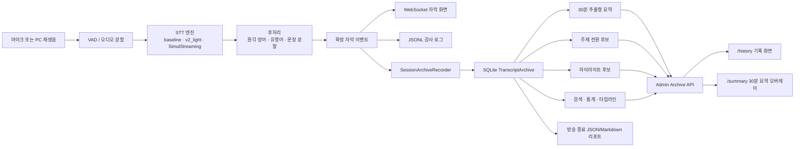
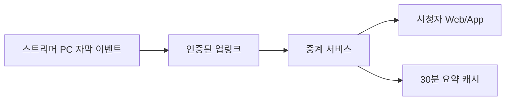

# Streamer Caption Phase 2·3 적용 보고서 및 아키텍처

- 작성일: 2026-07-11
- 프로젝트: `<project-root>`
- 아이디어 원문: `<reference-document>`
- 상태: 로컬 프로토타입 구현 및 자동 테스트 완료, 실제 방송 품질 검증 전
- 패키지: 이번 작업에서는 생성하지 않음
## 최신 구현 업데이트

- 관리자 페이지에 방송 분석 조정 탭을 추가했다.
- 균형, 전환 적게, 더 많이 찾기 프리셋을 제공한다.
- 요약 문장 수, 주제 비교 창, 전환 민감도, 쿨다운, 하이라이트 후보 수를 조절할 수 있다.
- 강한 표현, 웃음, 핵심어, 주제 전환 신호별 하이라이트 가중치를 조절할 수 있다.
- 저장 시 분석 캐시를 즉시 비우고 다음 기록·요약 조회부터 새 설정을 사용한다.
- 방송 리포트에 사용된 분석 설정과 하이라이트 점수 근거를 기록한다.
- 별도 최신 작업 우선 CPU 워커가 최근 30분 요약과 주제 전환을 계산한다.
- summary_updated와 topic_changed 이벤트를 WebSocket으로 전송한다.
- 새 접속자는 최신 주제와 요약 이벤트를 자막 동기화와 함께 받는다.
- 30분 요약 화면은 분석 이벤트를 받으면 15초 폴링을 기다리지 않고 갱신한다.

## 1. 결론

기존 실시간 자막 파이프라인을 다시 만들지 않고, 확정 자막 뒤에 독립적인 `세션 아카이브`를 붙였다. 실시간 자막 송출은 기존 WebSocket과 JSONL 로그를 그대로 사용하며, Phase 2·3 기능은 SQLite에서 조회한다.

이 구조의 핵심 장점은 다음과 같다.

1. 아카이브나 요약에서 오류가 나도 실시간 자막은 계속 동작한다.
2. 4060 Ti 16GB에서 별도 요약 모델을 GPU에 함께 올리지 않는다.
3. JSONL은 원본 감사 로그로 남고, SQLite는 검색과 화면 조회용 인덱스로 사용한다.
4. 방송 중에는 가벼운 로컬 추출형 분석만 수행하며, 고품질 AI 요약은 나중에 교체 가능한 단계로 남긴다.
5. 마이크 입력과 PC 재생음 입력이 같은 이벤트 계약을 사용하므로 방송자와 시청자 모드 모두 같은 기록 기능을 쓴다.

## 2. 현재 구현 상태

| 원문 기능 | 현재 상태 | 이번 구현 | 다음 수용 기준 |
|---|---|---|---|
| 신규 시청자용 30분 요약 | 프로토타입 완료 | `/summary`, `/history` 요약 패널 | 실제 2시간 방송에서 요약 유용성 평가 |
| 주제 전환 감지 알림 | 분석 프로토타입 | 키워드 중첩 기반 전환 후보 | 실시간 알림 이벤트, 오탐률 측정 |
| 실시간 대화 기록 뷰어 | 동작 완료 | 세션/30분 구간/자동 갱신 | 4시간 방송 성능 검증 |
| 방송 종료 후 자동 리포트 | 동작 완료 | JSON 및 Markdown 자동 생성 | 비정상 종료 때 복구 리포트 추가 |
| 방송 타임라인 시각화 | 프로토타입 완료 | 30분별 자막 밀도 막대 | 주제·하이라이트 레이어 선택 표시 |
| 키워드 시점 검색 | 동작 완료 | 한국어 부분 문자열 검색 | 형태소·유사어 검색은 후속 |
| 자동 하이라이트 추출 | 후보 추천 프로토타입 | 감탄·웃음·주제 전환·핵심어 점수 | 실제 클립 정답셋으로 정밀도 평가 |
| 치지직 다시보기 URL 연동 | 수동 매핑 프로토타입 | URL, 시작 보정 초, 자막 시점 표시 | 공식 VOD API 또는 검증된 딥링크 어댑터 |
| 유행어 탄생 기록 | 동작 완료 | 사전 추가·수정·삭제 이력 | 음성 샘플·최초 사용 세션 연결 |
| 음성 통계 대시보드 | 기본 통계 완료 | 길이·자막 수·분당 자막·글자 수 | 말하기 속도·침묵 비율·화자 통계 |

### 완성도 추정

- Phase 2 기능 기반 및 프로토타입: 약 80%
- Phase 3 기능 기반 및 프로토타입: 약 50%
- Phase 2·3 전체를 실제 방송용 완제품으로 본 추정치: 약 65%

이 수치는 코드 양이 아니라 실제 방송 수용 기준을 기준으로 한 추정이다. 남은 비중의 대부분은 실제 방송 데이터로 요약·주제·하이라이트 정확도를 검증하고 치지직 공식 연동 방식을 확정하는 작업이다.

## 3. 현재 아키텍처



### 장애 격리 원칙

`SessionArchiveRecorder`는 best-effort 방식이다. SQLite 쓰기나 리포트 생성이 실패하면 첫 오류만 경고하고 자막 이벤트 처리를 계속한다. 아카이브 장애가 STT, WebSocket, 자막 화면을 종료시키지 않는다.

## 4. 데이터 구조

### sessions

| 필드 | 용도 |
|---|---|
| `id` | 로그 폴더와 같은 세션 ID |
| `started_at`, `ended_at` | 방송 시작·종료 시각 |
| `source` | `microphone` 또는 `system` |
| `engine` | STT 엔진 |
| `title` | 사용자 지정 방송 제목 |
| `vod_url` | 사용자가 붙인 다시보기 주소 |
| `vod_start_offset_sec` | 로컬 방송 시점과 VOD 시작점 보정 |
| `metadata_json` | 모드, 프로필, 종료 상태 등 |

### captions

| 필드 | 용도 |
|---|---|
| `session_id` | 세션 연결 |
| `offset_sec`, `offset_ms` | 방송 시작 기준 시점 |
| `bucket_index` | 30분 구간 인덱스 |
| `text` | 방어·유행어 처리 후 확정 자막 |
| `confidence` | STT 신뢰도 |
| `engine` | 생성 엔진 |
| `metadata_json` | 원문, 분할 정보, 작업 정보 |

`(session_id, offset_ms, text)`를 고유 키로 사용해 STT 복구 뒤 같은 확정 결과가 다시 도착해도 중복 기록되지 않는다.

### slang_history

유행어 사전의 `added`, `updated`, `deleted` 이벤트와 이전 값을 기록한다. 현재는 사전 변경 이력이며, Phase 3 후속에서는 음성 샘플 ID와 최초 방송 사용 시점을 추가한다.

## 5. 주요 모듈

| 파일 | 책임 |
|---|---|
| `core/transcript_archive.py` | SQLite 스키마, 세션·자막·검색·통계·유행어 이력 |
| `core/session_archive.py` | 실시간 이벤트와 아카이브 사이의 장애 격리 어댑터 |
| `features/summarizer.py` | GPU 없는 키워드 및 추출형 30분 요약 |
| `features/topic_detector.py` | 구간별 키워드 중첩 기반 주제 전환 후보 |
| `features/highlights.py` | 하이라이트 후보 점수화 |
| `features/broadcast_report.py` | 방송 종료 리포트 생성 |
| `core/admin_server.py` | 기록 조회 API와 분석 캐시 |
| `overlay/history.html` | 세션·검색·타임라인·통계 통합 화면 |
| `overlay/summary.html` | 신규 시청자용 30분 요약 오버레이 |
| `tools/phase23_demo.py` | 운영 DB와 분리된 데모 데이터 및 서버 |
| `tools/check_phase23_ui.mjs` | Chrome 기반 데스크톱·모바일 UI 검사 |

## 6. API 계약

| 메서드와 경로 | 기능 |
|---|---|
| `GET /api/archive/sessions` | 최근 방송 세션 목록 |
| `GET /api/archive/latest` | 최신 세션·타임라인·통계 |
| `GET /api/archive/captions` | 세션 또는 30분 구간 자막 |
| `GET /api/archive/search` | 현재 세션 키워드 검색 |
| `GET /api/archive/summary` | 지정 구간 또는 실제 최근 30분 롤링 요약 |
| `GET /api/archive/timeline` | 통계·주제·하이라이트·타임라인 |
| `GET /api/archive/report` | 전체 방송 리포트 JSON |
| `GET /api/archive/slang-history` | 유행어 변경 이력 |
| `POST /api/archive/session-meta` | 방송 제목·VOD 주소·시작 보정 저장 |

모든 API는 현재 `127.0.0.1` 관리자 서버 안에서만 쓰는 로컬 API다. 외부 시청자 공개 기능으로 전환할 때는 인증, 접근 제어, TLS, 요청 제한을 먼저 추가해야 한다.

## 7. 기능별 구체화 방안

### 7.1 30분 요약

현재 방식은 로컬 추출형 요약이다. 확정 자막에서 핵심어 빈도와 문장 대표성을 계산하고 서로 비슷한 문장을 제외한 뒤 최대 5개를 고른다. `/history`는 비교가 쉬운 고정 30분 구간을 사용하고, `/summary`는 마지막 확정 자막 시점에서 정확히 1,800초를 거슬러 올라가는 롤링 범위를 사용한다. 한국어 조사·어미를 가볍게 정규화하고 방송 말버릇을 불용어로 제외한다.

- 장점: 추가 VRAM 0, 네트워크 0, 즉시 동작, 개인정보 외부 전송 없음
- 한계: 말의 의도나 숨은 맥락을 새 문장으로 재작성하지 못함
- 다음 단계: `SummaryProvider` 인터페이스를 두고 `LocalExtractiveProvider`, `PostBroadcastLlmProvider`를 교체 가능하게 구성
- 4060 Ti 원칙: 방송 중 두 번째 대형 GPU 모델 금지. LLM 요약은 방송 종료 후 또는 별도 서버에서 수행

### 7.2 주제 전환 알림

현재는 여러 자막을 한 블록으로 묶고 이전 블록과 핵심어 Jaccard 유사도를 비교한다. 유사도가 기준보다 낮고 쿨다운을 통과하면 전환 후보가 된다.

후속 실시간 알림은 다음 이벤트 계약을 사용한다.

```json
{
  "event_type": "topic_changed",
  "session_id": "2026-07-11_190000_123",
  "audio_offset_sec": 1810.0,
  "label": "게임 · 레이드 · 보스",
  "confidence": 0.78
}
```

실제 방송 5회 이상에서 후보를 사람이 표시해 정밀도 70% 이상, 같은 주제의 반복 알림 간격 2분 이상을 1차 수용 기준으로 권장한다.

### 7.3 대화 기록과 검색

SQLite는 확정 자막만 기록한다. 임시 자막과 방어 필터에서 숨겨진 환각 문장은 검색 결과에 들어가지 않는다. 현재 검색은 한국어 부분 문자열 방식이라 고유명사와 유행어 검색에는 안정적이다.

형태소 검색은 후속 기능이다. 한국어 FTS 토크나이저를 확인하기 전까지 임의로 단어를 잘라 저장하지 않는다.

### 7.4 자동 하이라이트

현재 결과는 “클립”이 아니라 “후보 시점”이다. 다음 신호를 조합한다.

- 감탄문·의문문
- 웃음 표현
- 세션 핵심어 포함
- 주제 전환 직후
- 문장 길이와 STT 신뢰도

실제 자동 클립 생성은 후보 시점 앞 15초, 뒤 30초의 영상 구간을 방송 녹화 파일에서 잘라내는 별도 `ClipExporter`가 필요하다. 자막 프로젝트가 영상을 직접 녹화하지 않으므로 OBS 녹화 파일 또는 VOD가 없으면 클립 파일은 만들 수 없다.

### 7.5 치지직 다시보기

현재 프로토타입은 사용자가 VOD 주소와 시작 보정 초를 저장하고, 자막 시점을 `VOD 시작 보정 + 자막 offset`으로 표시한다. 임의의 URL 쿼리 규칙을 추측해 붙이지 않는다.

2026-07-11 기준 공식 CHZZK Developers 문서의 공개 API 카테고리는 User, Channel, Category, Live, Chat, Drops, Restriction이며 VOD 조회 카테고리는 문서에서 확인되지 않는다. 따라서 비공식 엔드포인트 스크래핑을 제품 아키텍처에 넣지 않는다. 공식 문서: <https://chzzk.gitbook.io/chzzk>

후속 `ReplayLinkAdapter` 계약은 다음과 같다.

```text
resolve(session metadata) -> replay identity
map(audio_offset_sec, start_correction_sec) -> replay time
build_link(replay identity, replay time) -> verified URL or base URL + displayed time
```

공식 VOD API나 안정적인 타임스탬프 딥링크가 확인되면 `ChzzkReplayAdapter`만 추가하고 SQLite·화면·검색은 바꾸지 않는다.

### 7.6 유행어 탄생 기록

현재 사전 변경 이력은 구현됐다. 음성 샘플 기반 유행어 기능은 다음 구조로 확장한다.

1. 사용자가 표준어, 발음 변형 텍스트, 짧은 음성 샘플을 등록한다.
2. 텍스트 변형은 현재 사전과 Whisper prompt에 사용한다.
3. 음성 샘플은 임베딩만 저장하고 원본 보관 여부를 사용자가 선택한다.
4. 낮은 STT 신뢰도 구간에서만 음성 유사도를 보조 신호로 사용한다.
5. 음성 유사도만으로 단어를 강제 치환하지 않고 VAD·문맥·신뢰도 조건을 함께 확인한다.

4060 Ti에서는 별도 음성 임베딩 모델을 상시 GPU에 두지 않고 CPU 경량 모델 또는 STT 종료 후 배치 처리를 우선한다.

### 7.7 방송을 듣는 사람의 자막

현재 `audio.source=system`이 PC에서 재생되는 방송 소리를 입력으로 사용한다. 이 모드는 같은 아카이브와 Phase 2·3 기능을 그대로 사용한다.

현재 한계는 선택한 Windows 출력 장치의 모든 소리가 섞인다는 점이다. 특정 브라우저 탭이나 앱만 분리하는 기능은 후속 `ApplicationAudioSource`로 분리한다.

외부 시청자에게 자막을 배포하려면 스트리머 PC의 로컬 서버를 인터넷에 직접 노출하지 않는다. 권장 구조는 다음과 같다.



## 8. 4060 Ti / 5070 Ti 운용 원칙

| 항목 | RTX 4060 Ti 16GB | RTX 5070 Ti 16GB |
|---|---|---|
| STT | 기존 안정 프리셋 우선 | 품질 프리셋 또는 SimulStreaming 실험 |
| SQLite 저장 | CPU, 영향 미미 | 동일 |
| 추출형 요약 | CPU | CPU |
| 로컬 대형 LLM 동시 실행 | 금지 권장 | 방송 중에는 비권장 |
| 고품질 사후 요약 | 방송 종료 후 순차 실행 | 방송 종료 후 순차 실행 |
| 분석 갱신 | 자막 수가 바뀔 때만 재계산 | 동일 |

관리자 타임라인 API는 같은 세션의 자막 수와 메타데이터가 바뀌지 않으면 분석 결과를 재사용한다. 긴 방송에서 5초마다 전체 요약을 다시 만드는 구조가 아니다.

## 9. 보존·보안·개인정보

- 원본 오디오는 아카이브에 저장하지 않는다.
- 확정 자막과 메타데이터만 `data/transcripts.sqlite3`에 저장한다.
- 업데이트 ZIP은 기존 아카이브 DB와 SQLite 보조 파일을 제외해 덮어쓰지 않는다.
- 세션 ID에는 밀리초를 포함해 빠른 재시작 때 로그가 합쳐지지 않는다.
- 외부 공개 전에는 사용자별 접근 토큰, TLS, 보존 기간, 삭제 기능이 필수다.
- 로컬 기록과 설정이 임의 웹사이트에 노출되지 않도록 전체 허용 CORS 헤더를 제거했다.
- 정적 화면과 JSON 응답에는 `Cache-Control: no-store`, `X-Content-Type-Options: nosniff`, `Referrer-Policy: no-referrer`를 보낸다.
- 향후 `retention_days`와 세션 삭제·내보내기 UI를 추가한다.

## 10. 전문가 집중 보완 결과

| 발견한 문제 | 위험 | 적용한 보완 |
|---|---|---|
| API 요청마다 SQLite 초기화 | 잠금 경쟁과 불필요한 디스크 작업 | 서버 수명 동안 공유하는 지연 초기화 저장소로 변경 |
| 최근 30분이 고정 구간 | 방송 중간 접속자에게 30분보다 짧은 내용 표시 | `/summary`를 실제 1,800초 롤링 범위로 변경 |
| 리포트 20,000개 제한 | 장시간 방송 후반 자막이 조용히 누락 | 내부 리포트 조회는 제한 없이 전체 확정 자막 사용 |
| 전체 허용 CORS | 악성 웹페이지가 로컬 기록을 읽을 가능성 | CORS 전체 허용 제거 및 보안·비캐시 헤더 추가 |
| 한국어 조사와 말버릇 | 요약 제목이 `보겠습니다`, `다음`처럼 잡힘 | 조사·어미 정규화와 방송 불용어 보강 |
| VOD 보정값이 양수 전용 | 녹화 시작 순서가 반대면 시점 보정 불가 | -86,400초부터 +86,400초까지 허용 |
| 전체 분석 5초 반복 | 장시간 방송에서 CPU 경쟁 | 자막 목록은 5초, 전체 인사이트는 30초 주기로 분리 |
| 분석 캐시 무제한 | 많은 세션 열람 후 메모리 증가 | 최대 64개 결과로 제한 |
| baseline 예외 시 세션 미종료 | 종료 리포트와 종료 상태 누락 | 오류 이벤트 기록 후 세션 종료·리포트 생성 |
| 데모 재실행 이력 중복 | 유행어 이력 화면 오염 | 데모 시드 작업을 멱등 처리 |

## 11. 사용 방법

### 실제 자막과 함께 사용

1. 평소처럼 `v2_light` 또는 SimulStreaming 실험을 실행한다.
2. 관리자 서버가 켜진 상태에서 `http://127.0.0.1:8766/history`를 연다.
3. 신규 시청자용 요약은 `http://127.0.0.1:8766/summary`를 연다.
4. 방송 종료 후 해당 `logs/<session>/` 폴더의 `broadcast_report.json`과 `broadcast_report.md`를 확인한다.

### GPU와 마이크 없이 프로토타입 확인

`PREVIEW_PHASE23.bat`를 실행한다. 운영 아카이브가 아니라 `reports/phase23_demo/`의 별도 데모 DB를 사용한다.

## 12. 검증 결과

- Python 전체 문법 검사 통과
- Phase 2·3 아카이브·분석·리포트 테스트 통과
- 기록·검색·요약·타임라인·VOD 메타 API 통합 테스트 통과
- 기존 자막 후처리·유행어·STT 복구·SimulStreaming·오디오 소스·WebSocket 회귀 테스트 통과
- Chrome 데스크톱 1440×900 렌더링 통과
- Chrome 모바일 390×844 렌더링 통과
- 데스크톱·모바일 가로 넘침 없음
- 브라우저 콘솔 오류 없음
- 롤링 요약 범위가 마지막 시점 기준 정확히 1,800초인지 검증
- 한국어 핵심어가 조사 제거 후 주제어 중심으로 나오는지 검증

## 13. 다음 개발 순서

### 1순위: 실제 방송 수용 테스트

1. 4060 Ti에서 2시간 이상 방송한다.
2. 세션 자막 수, DB 크기, `/history` 응답 시간, STT 지연을 기록한다.
3. 30분 요약마다 유용/불필요 문장을 표시한다.
4. 주제 전환 후보와 실제 전환을 비교한다.
5. 하이라이트 후보 중 실제로 다시 보고 싶은 비율을 계산한다.

### 2순위: 정확도 조정 화면 (구현 완료)

- 요약 문장 수 3~7
- 주제 창 크기와 유사도 기준
- 주제 전환 쿨다운
- 하이라이트 신호별 가중치
- 기록 보존 기간과 세션 삭제
현재 관리자 분석 탭에서 위 분석 정확도 항목을 조정할 수 있다. 기록 보존과
세션 삭제는 방송 기록 화면에서 제공한다. 다음 코드 개발 우선순위는 실시간
이벤트화이며, 정확도 수용 기준은 실제 방송 검증으로 확정한다.

### 3순위: 실시간 이벤트화 (요약·주제 기반 구현 완료)

- `topic_changed` WebSocket 이벤트
- 새 시청자 접속 시 현재 30분 요약 전송
- 방송 종료 이벤트와 리포트 상태 표시
- 분석 작업을 별도 저우선순위 워커로 분리

### 4순위: 플랫폼·영상 어댑터

- 검증된 치지직 VOD 식별·딥링크 어댑터
- OBS 녹화 파일 인덱서
- 하이라이트 실제 클립 내보내기
- 외부 시청자용 인증 중계 서비스

## 14. 완료 판정 기준

다음 조건을 모두 만족하면 Phase 2를 실제 방송용 완료로 본다.

1. 4060 Ti에서 4시간 방송 중 STT 지연 증가가 기준 이내다.
2. 종료 후 확정 자막 누락률이 JSONL 대비 0%다.
3. 기록 화면의 95퍼센타일 API 응답이 500ms 이하다.
4. 30분 요약의 유용 문장 비율이 70% 이상이다.
5. 주제 전환 알림 정밀도가 70% 이상이다.
6. 비정상 종료 후에도 마지막 커밋 자막까지 조회된다.

Phase 3 완료는 실제 하이라이트 평가셋, 공식 또는 합법적으로 검증된 VOD 연동, 세션 삭제·내보내기, 외부 시청자 인증 배포가 추가로 필요하다.
## 15. Broadcast lifecycle completion

방송 종료 흐름을 다음 계약으로 고정했다.

1. 마지막 확정 자막까지 SQLite 세션에 기록한다.
2. 실시간 분석 작업을 강제로 한 번 갱신하고 제한 시간 안에 종료한다.
3. 세션을 종료 상태로 바꾸고 `broadcast_report.json`, `broadcast_report.md`를 생성한다.
4. `broadcast_ended` 이벤트에 세션 ID, 마지막 음성 시점, 리포트 경로, 종료 메타데이터를 넣는다.
5. 이벤트를 `session.jsonl`에 기록하고 WebSocket 전달 완료를 최대 1초 기다린다.
6. `/summary` 화면은 이벤트를 받는 즉시 `방송 종료` 상태로 바뀌며 최종 리포트를 다시 불러온다.
7. 새로 접속한 화면에도 최근 `broadcast_ended` 이벤트를 동기화한다.

자동 검증은 `tests/test_broadcast_lifecycle.py`에서 리포트 생성, JSONL 기록, WebSocket 캐시, 전달 대기, 요약 화면 연결을 함께 확인한다. 운영 PC에서는 방송 종료 뒤 `logs/<session>/broadcast_report.json`과 `session.jsonl`의 `broadcast_ended` 항목을 확인하면 된다.
